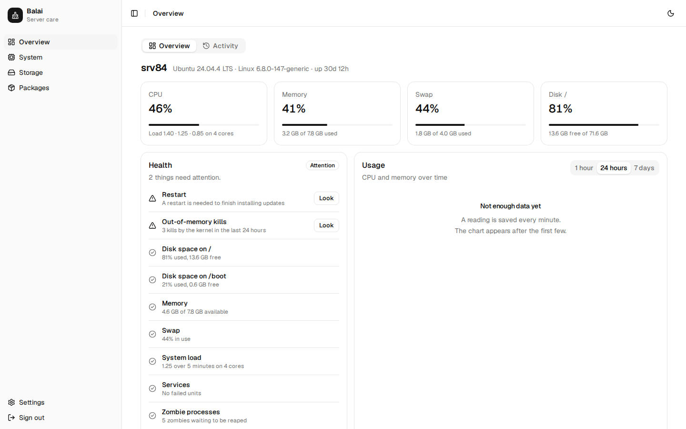
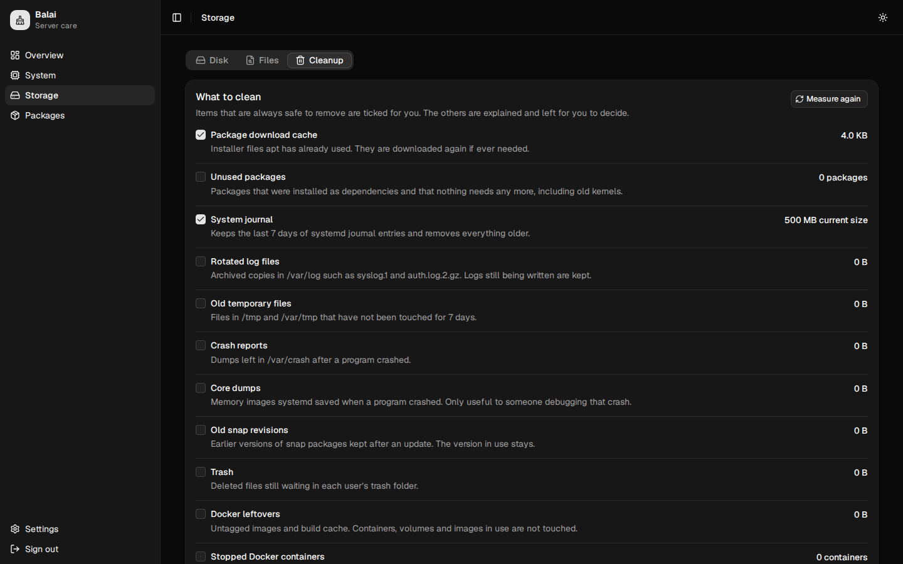

<div align="center">


# Balai

**Keep your server clean and healthy.**

A small web panel for Linux servers.<br>
See what is wrong, act on it and free disk space, without agents, accounts or outside services.

[](package.json)
[](LICENSE)
[](#requirements)
[](https://bun.sh)
[](web)

[Install](#install) · [Features](#features) · [Updating](#updating) · [Report a bug](https://github.com/toscani-tenekeu/balai/issues/new) · [Windows version](https://github.com/toscani-tenekeu/balai-windows)



</div>

---

## Features

Balai is organised in four sections, each with a few tabs.

| Section | What you get |
| --- | --- |
| **Overview** | CPU, memory, swap and disk at a glance, a usage chart for the last hour, day or week, and health checks: full disks, exhausted inodes, low memory, heavy swap, high load, failed services, zombie processes, pending security updates, a needed restart, out-of-memory kills and an unsynchronised clock. **Activity** keeps a record of everything done from the panel. |
| **System** | **Processes**: what uses CPU and memory; stop or force stop. **Services**: start, stop, restart, enable or disable services (systemd, or OpenRC on Alpine) and read their logs. **Ports**: which programs listen, whether they are reachable from outside, and stop or restart what holds a port. |
| **Storage** | **Disk**: every filesystem, and a folder browser that shows where the space goes. **Files**: find files by extension, size or age anywhere, such as every `.zip` or everything over 250 MB, and see whether each one is used: live on a website (with its address, the pages that link to it and how often it was requested), in an old release, in a project and its git state, a copy of a live file, open in a program, or not used anywhere. **Cleanup**: the package cache, unused packages and old kernels, the journal, old logs, temporary files, crash reports, snap revisions, Docker leftovers, old website releases, developer caches and more, each showing what it frees, with an optional weekly run. |
| **Packages** | Available updates with security updates marked, how much they download, how much space they take once installed, how long they should take on this server and how much free disk space is left afterwards. Updates held back and updates that need a restart are pointed out. Install one or all of them, and uninstall packages you no longer use. |

Actions sit right on each row, and every action that changes the server asks for
confirmation and says what it will do. Long work (searches, cleanups, deleting a large
folder, package updates) runs as a task: the **Tasks** menu shows its progress, steps and
output, and a task can be cancelled at once, stopping every program it started. Package
installs are the exception and run to the end, as stopping them halfway can break packages. Files and packages the operating system
needs are shown but cannot be removed. Balai also updates itself from **Settings**.

<div align="center">

</div>

## Requirements

- A 64-bit Linux server (x86-64 or ARM64) with Linux 5.1 or newer
- Root access
- About 1 GB of free memory while installing or updating, to build the interface
- One of: Debian, Ubuntu, Linux Mint, RHEL, Rocky Linux, AlmaLinux, CentOS Stream, Fedora, Oracle Linux, Amazon Linux 2023, openSUSE, Arch Linux, Manjaro or Alpine Linux

Balai works with each system's own tools: apt, dnf or yum, zypper, pacman or apk
for packages, and systemd or OpenRC for services. A few things depend on the
system:

- Updates are marked as security fixes on Debian, Ubuntu and the Red Hat family.
- Arch and Manjaro install all updates together, as they require.
- Uninstalling a package together with its settings is offered where the package manager can do it (apt, pacman, apk).

## Install

```bash
curl -fsSL https://raw.githubusercontent.com/toscani-tenekeu/balai/main/install.sh | sudo bash
```

The script installs the few system tools Balai reads from and [Bun](https://bun.sh)
with your distribution's package manager, downloads Balai to `/opt/balai`, builds
the interface and starts it as a systemd service (OpenRC on Alpine). When it
finishes it prints two things:

```
Setup link:      http://203.0.113.10:7070/setup?token=…
Admin password:  …
```

Open the setup link once to choose your own password. If you would rather keep
the generated password, sign in with it; the link stops working either way.

The same information is kept in `/opt/balai/data/first-run.txt` until setup is
done.

### Settings

Pass these as environment variables to `install.sh`:

| Variable     | Default      | Meaning                                         |
| ------------ | ------------ | ----------------------------------------------- |
| `BALAI_DIR`  | `/opt/balai` | Where Balai is installed                        |
| `BALAI_HOST` | `0.0.0.0`    | Address to listen on                            |
| `BALAI_PORT` | `7070`       | Port to listen on                               |
| `BALAI_URL`  | none         | Public address, used to print the setup link    |

## Using a domain name

Balai works with just the server's IP address, but then your password travels
over plain HTTP. A domain name with HTTPS is recommended. Make Balai listen
locally and put a web server in front of it:

```bash
curl -fsSL https://raw.githubusercontent.com/toscani-tenekeu/balai/main/install.sh \
  | sudo BALAI_HOST=127.0.0.1 BALAI_URL=https://balai.example.com bash
```

```nginx
server {
    server_name balai.example.com;

    location / {
        proxy_pass http://127.0.0.1:7070;
        proxy_set_header Host $host;
        proxy_set_header X-Forwarded-Proto $scheme;
        proxy_read_timeout 300s;
    }
}
```

Then get a certificate, for example with `sudo certbot --nginx -d balai.example.com`.

## Updating

Open **Settings** and choose **Check for updates**, then **Install update**. Balai
downloads the new version, builds it next to the running one, swaps it in and
restarts. If anything fails, it stays on the version it had.

Turn on **Install updates automatically** to have this done every six hours.

## Day to day

```bash
systemctl status balai            # is it running (rc-service balai status on Alpine)
journalctl -u balai -f            # logs (/var/log/balai.log on Alpine)
cd /opt/balai && bun run passwd   # reset a forgotten password
```

## Uninstall

```bash
sudo systemctl disable --now balai
sudo rm /etc/systemd/system/balai.service
sudo rm -rf /opt/balai
```

On Alpine: `rc-update del balai && rc-service balai stop && rm /etc/init.d/balai`.

## How it is built

- **Server**: [Bun](https://bun.sh), with its built-in SQLite driver. No other runtime dependencies.
- **Interface**: Vue 3 with [shadcn-vue](https://www.shadcn-vue.com) components and Tailwind CSS.
- **Data**: one SQLite file in `data/`, holding the password hash, sessions, usage readings (7 days) and the activity record (90 days).

System commands are always started with an explicit argument list and never
through a shell.

### Development

```bash
bun install && (cd web && bun install)
bun run build          # build the interface once
bun run dev:server     # API on http://127.0.0.1:7070
bun run dev:web        # interface with hot reload, proxying /api
```

## License

MIT
